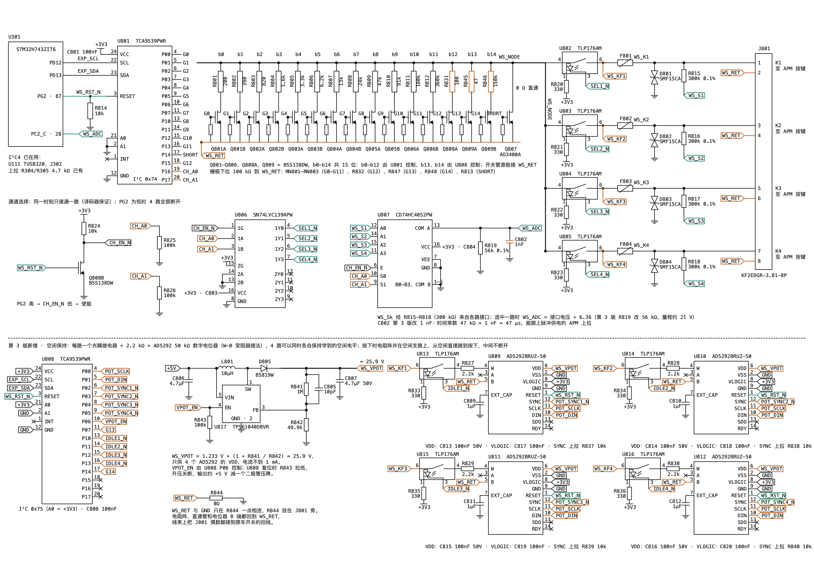
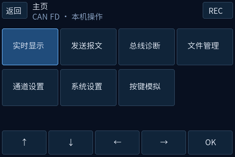
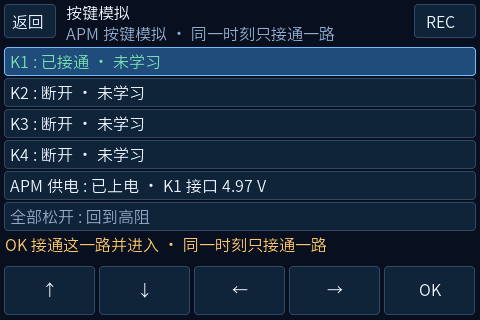
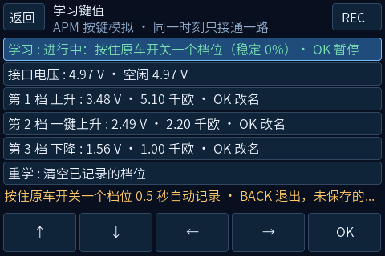

# APM 按键模拟：进展

在 Hardware-C 监控器上增加 APM 车窗开关的按键模拟：设备在 APM 的按键输入上模拟原车开关的各个档位，可以学习原车开关的键值、扫描 APM 的档位门限，再用学到的键值去“按”APM。最多 4 路，同一时刻只按一路。

思路只有一条：APM 只认它引脚上的电压。学习时记下空闲电压和各档按下时的电压，发出时用电阻把引脚拉到同样的电压。第 3 版按这条思路去掉了对具体车型的依赖：驱动先辨识每一路 APM 一侧的等效电源，不再假定 2.2 kΩ 上拉；原车开关空闲时接着电阻的车，拔掉开关后由空闲保持支路接替。

## 现在到哪一步

| 部分 | 状态 | 位置 |
| --- | --- | --- |
| 原理图第 12 页第 3 版 | 设计完成，是提案；还没画进嘉立创EDA，没有 PCB | `schematic/page12-rev3.*` |
| 驱动（winsim） | 第 3 版完成：辨识、回读微调、15 位电阻阵、空闲保持、脉冲上拉；主机测试通过 | `fw/services/winsim/` |
| 按键模拟服务和界面（keysim） | 完成，桌面模拟器里可以操作；Rev D/E 固件上不显示入口 | `fw/services/keysim/`、`fw/app/ui/core/ui_sm.c` |
| 键值表存 SD 卡 | 完成；板级存储代码在 RAM 卡上测试通过 | `fw/services/keysim/keysim_file.*`、`fw/platform/stm32h743_revd/storage_files.inc` |
| 交互原型和现有界面梳理 | 完成，作为讨论记录保留 | `ui/` |
| Hardware-C 板级移植、实板联调 | 没开始 | — |



## 定下来的方案

第 3 版在第 2 版上的改动（详见 `schematic/page12-rev3.html` 的“和第 2 版相比改了什么”）：

- **辨识代替假定。** 每路接 0 Ω 直通和一个已知电阻各量一次，解出 APM 一侧的开路电压、内阻和这一路的串联电阻，再按回读微调。仿真里 APM 上拉 1–10 kΩ、上拉到 5 V 或 3.3 V 都能用，最差误差 6–28 mV。
- **每路一个空闲保持支路。** 光耦继电器 + 2.2 kΩ + AD5292 50 kΩ 数字电位器（W–B 变阻器接法），4 路可以同时保持各自学到的空闲电平；按下时电阻阵并在空闲支路上，从空闲直接跳到按下，中间不经过开路。建立空闲时只用这条支路本身测量，接口电压始终在开路和空闲之间。第 2 版的空闲电阻预留位 R827–R830 取消。
- **新增 U808（第二片 TCA9539 @0x75）和 U817 升压。** U808 位操作电位器的 SPI、驱动空闲继电器，空脚给电阻阵加了 b13 = 47 Ω、b14 = 150 kΩ（补 1 kΩ 和 10 kΩ 上拉时的两端）；U817 把 +5V 升到约 25.9 V 给电位器的 VDD。主控引脚仍只用 PG2、PC2_C。
- **回线改到 WS_RET。** 电阻阵、直通管、电位器 B 端和 J801 偶数脚接 WS_RET，经 R844 单点接地；线束上接原车开关的回线，车窗电机电流造成的地电位差不进按键电压。
- **回读改快、量程加大。** C802 10 nF → 1 nF，R819 100 kΩ → 56 kΩ：时间常数约 47 µs，能分辨脉冲供电的上拉；量程约 21 V，上拉到蓄电池电压的输入也能测（过压门限在配置里调）。
- **驱动不再建查找表。** 15 位遍历求解，驱动上下文从约 33 KB 降到约 1.7 KB。

以下沿用第 2 版：

- **4 路共用一套电阻阵。** 因为同一时刻只按一路，K1–K4 用 4 个 TLP176AM 光耦继电器分别接到公共节点，SN74LVC139A 译码，硬件上保证不会同时接通两路。PG2 为低时 4 路全断。
- **回读在每路接口侧。** 300 kΩ 分压上臂放在各路接口，CD74HC4052 选通后经下臂接 PC2_C。这样任何一路都能在原车开关接着时被动学习。
- **主控引脚只用 PG2、PC2_C**，PC3_C 仍空着；I/O 扩展挂在现有的 I2C4。
- **键值表存 SD 卡**，每路一个纯文本文件 `/APMKEY/K1.TXT … K4.TXT`，电脑上可以直接看、改、拷到别的设备。第 3 版多了可选的 `idle=` 一行（学到的空闲电压）。
- **Hardware-C 是纯触摸**，主控上没有按键，电源是拨动开关 SW101。现有界面里依赖实体键的长按回主页、POWER 熄屏和关机、组合键锁键、开机进升级，在新板上都要改；详见 `ui/ui-logic-map.html`。

## 界面

主页第 7 格“按键模拟”，主页变成 4×2。下面四页都是设备现有的列表样式：

- **总览：** K1–K4 是否接通、有没有键值表、是否已存 SD；APM 供电；全部松开。
- **通道页：** 接口电压和 APM 判定、按法（点按 300 ms / 保持）、各键、手动电压、学习、扫描、辨识（显示 APM 上拉和串联电阻）、空闲保持、键值表存储状态。
- **空闲保持：** 默认关。原车开关拔掉后在通道页打开；拔掉开关后自动接通，接回开关时后台约 1.2 s 内发现接口被拉低并断开。接回原车开关前要先关，否则两者并联，APM 可能把它看成一次按键。
- **学习键值：** 按住原车开关一个档位 0.5 秒自动记一档，显示电压和反推的开关电阻。
- **门限扫描：** 从 4.8 V 每 50 mV 往下设，读 APM 开关状态，记下门限，保存时每档取中点。

| 主页 | 总览 | 学习 |
| --- | --- | --- |
|  |  |  |

这几张是 `run_ui_host.py` 在电脑上运行真实 LVGL 代码画出的设备画面（480×320）。

## 怎么试

```sh
make -C fw sim
```

打开 http://localhost:8765，启动设备后点主页的“按键模拟”。右侧“环境”里的台架可以唤醒或休眠 APM、给每一路接上或断开原车开关、按住某个档位、模拟误接 12 V，还能改每路的 APM 上拉和原车开关空闲时的电阻。学好一路并保存后，长按 POWER 关机再开机，键值表会从模拟 SD 卡读回来。

测试：

```sh
make -C fw test-winsim                                # 驱动
make -C fw build/host/test_keysim_ui && fw/build/host/test_keysim_ui
make -C fw test                                       # 全部主机测试，含上面两个和 SD 存储
```

## 测试和构建结果

- 第 3 版：驱动 3630 项、界面 612 项（新增空闲保持和 10 kΩ 上拉 APM 两个场景）、键值表文件格式 58 项、板级 SD 存储（`test_storage_sd_winsim`）全部通过，均在 ASan/UBSan 下运行；`make -C fw test` 全部通过。
- `make -f Makefile.arm BOARD=reve check`（Arm GNU Toolchain 15.2.Rel1）通过；Rev E 上按键模拟是空壳，主页仍是 6 格。
- 只在有这部分硬件的目标上编译的代码（定义 `CANFD_WINSIM_HW`）用 Arm GCC 单独编译，`-Wall -Wextra -Werror -Wdouble-promotion` 没有告警：代码约 13.7 KB，RAM 约 1.7 KB，最大栈帧 184 B。
- 仿真精度和空闲保持的结果见 `fw/services/winsim/README.md` 的“已验证和未验证”。
- 与本工作无关、在 main 上同样失败的：`test-web` 里依赖 canmatrix 的几项（本机没装），一项 macOS 上的并发连接测试，以及 `test-rtos` 的链接错误（它的源文件列表少了文件）。

## 还没定、还没做

- **扫描用的 APM 开关状态信号**（哪条 CAN 报文、哪个字段）还没有配置界面。模拟器里由仿真 APM 直接给出，真实 APM 上现在读不到，扫描用不了。
- **空闲保持的覆盖范围：** 空闲电阻约 2.3–52 kΩ。APM 上拉 10 kΩ 时，空闲电压只能保持在 0.92–4.10 V；空闲电阻更大的车要么开路要么换 AD5292BRUZ-100（同封装，低阻端分辨率变粗）。
- **接回原车开关的风险：** 空闲保持中直接接回原车开关，两者并联约 1.2 s，APM 可能看成一次按键。界面已提示“接回前先关”，后台检查只是兜底。
- **辨识会短暂接通 0 Ω 直通和一个已知电阻**（各约 10 ms），在选通道和“重新辨识”时发生。去抖很短的 APM 可能把它当成一次按键，要在实车上确认。
- **上拉到蓄电池电压的车：** 硬件量程够了，但默认过压门限是 5.5 V，要在配置里调到 16 V；界面还没有这个设置。
- **PTC 料号**没定。15 V 的 TVS 只按 12 V 车设计，误接 24 V 会烧。新器件的立创料号还没在嘉立创库里核对，L801 型号待定。
- **“按住才生效”的按法**需要触摸的按下 / 抬起事件，现有手势只有点击，所以只做了点按和保持。
- **APM 唤醒报文**仍需在发送报文页手动发。
- **Hardware-C 纯触摸要改的交互**（主页按钮、关机、锁键、升级入口）和**板级移植**（I2C4、PG2、ADC3_INP0 回调，定义 `CANFD_WINSIM_HW`）没做。
- 原理图没画进嘉立创EDA，没有 PCB、DRC，也没有实板测试；遍历求解在目标板上的耗时没有实测。

## 本目录的文件

| 文件 | 内容 |
| --- | --- |
| `schematic/page12-rev3.html` | 第 12 页第 3 版：原理图、空闲保持的工作方式和覆盖范围、U801/U808 引脚分配、电阻阵、元件清单、逐脚网表。下载后用浏览器打开 |
| `schematic/page12-rev3.svg` / `.png` | 原理图图片 |
| `schematic/page12-rev3-netlist.json` | 逐脚网表（108 个器件、412 个引脚），格式与 Hardware-C 的 schematic-pins.json 相同，画完 EDA 后可以逐脚对照 |
| `tools/gen_page12_v3.py` | 生成上面这几个文件的脚本：`python3 gen_page12_v3.py out.html preview.svg netlist.json` |
| `schematic/page12-rev2.*`、`tools/gen_page12_v2.py` | 第 2 版，留作对照 |
| `ui/ui-logic-map.html` | 现有界面的页面导航、按键与触摸映射、Hardware-C 上要改的地方。末尾的“草案”是实现之前的设想 |
| `ui/prototype.html` | 实现之前做的可点击原型，用来讨论交互。和实际实现的差别：原型的入口在主页第 3 格、有“按住”按法、用自定义卡片布局；实际实现放在第 7 格、只有点按和保持、沿用设备的列表样式 |
| `ui/device-screens/` | 实际实现后的设备画面 |

HTML 文件在 GitHub 上只显示源码，下载后用浏览器打开即可，不需要联网以外的任何依赖。
