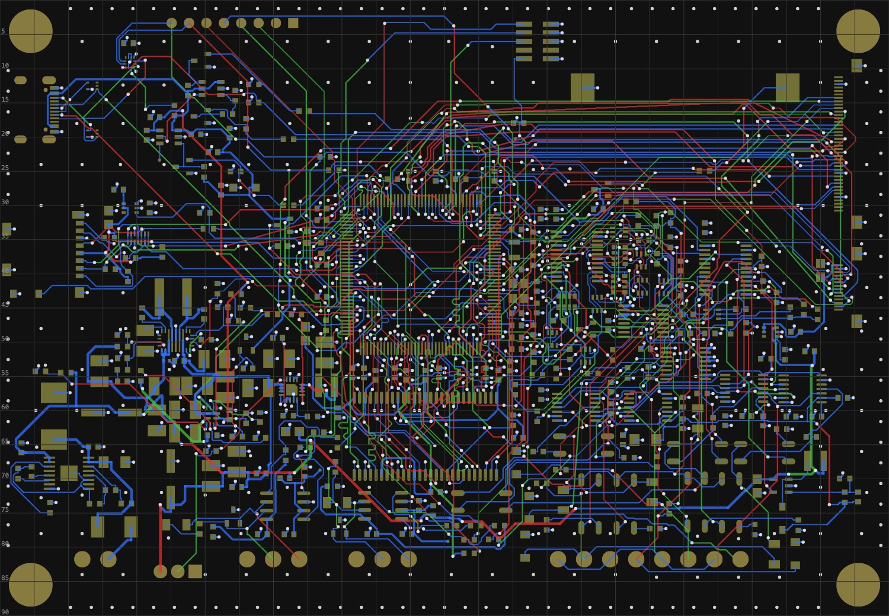

# Hardware-C v2（6 层板）

嘉立创EDA 专业版工程，130 × 90 mm，6 层 1.6 mm。元件全部在背面，4.0 英寸显示屏贴在正面。

## 状态（2026-11-28）

- 嘉立创EDA DRC：0 错误（间距、孔距、连通性），已加泪滴并重新铺铜。
- 全部网络连通；离线间距检查 0 违规。
- 过孔不压贴片焊盘：按真实焊盘形状检查，只剩 U201 底部散热焊盘里的散热过孔（常规做法）。
- **还没有打样，也没有上电验证。** 建议先打 5 片样板做整机测试，再小批量生产。

## 文件

| 路径 | 内容 |
|---|---|
| `easyeda/Hardware-C-v2.eprj2` | 嘉立创EDA 专业版工程（原理图 + PCB），在 EasyEDA Pro 里用"文件 → 打开"导入 |
| `fab/Hardware-C_v2_6L_gerber.zip` | Gerber + 钻孔（6 层） |
| `fab/Hardware-C_v2_6L_bom.csv` | BOM，带立创编号（UTF-16，制表符分隔） |
| `fab/Hardware-C_v2_6L_cpl.csv` | 贴片坐标（UTF-16），全部在底面 |
| `renders/` | 3D 预览截图和整板走线图 |
| `report/delivery-report.html` | 交付说明：叠层、SDRAM 长度与时序偏差、改动和复核项 |

## 叠层

| 层 | 用途 |
|---|---|
| L1 顶层 | 信号 + GND 填充 |
| L2 GND1 | 整层 GND |
| L3 SIG3 | 信号 + GND 填充 |
| L4 PWR_3V3 | 整层 +3V3 |
| L5 GND2 | 整层 GND |
| L6 底层 | 元件 + 信号 + GND 填充 + 电源级按网络铺铜 |

按嘉立创 6 层 1.6 mm 标准叠层 JLC06161H-3313 估算，外层 0.15 mm 线约 51 Ω，L3 约 62–68 Ω。USB 为全速，SDRAM 线较短，下单不需要选阻抗控制。

## 下单注意

- 选 6 层、1.6 mm、叠层 JLC06161H-3313，过孔盖油，只贴底面。
- 原理图里设为"不加入 BOM"的件不会被贴：J103（电源输入端子）、J401/J402（CAN 端子）、J301（SWD）、J302（扩展排针）、J503（RGB 接口，预留）、R417/R427（0R 选焊）、C737（10 µF 选焊）。需要的话手焊，或在嘉立创EDA 里把它们改为加入 BOM。
- 扩展库料 68 种，下单时核对库存。

## 待实物验证

- 整机上电、MCU、USB、CAN、显示、microSD。
- APM 按键模拟 rev 3：D805（B5819W）极性、接真实 APM 时的识别瞬态。
- 显示屏排线绕到 J501 的长度、外壳和接插件高度。
- 固件引脚表和本板（STM32H743ZIT6，LQFP144）是否一致。

## 已知取舍

- SDRAM 没有严格等长：数据线 5.7–73.6 mm，地址/控制线 7.3–58.4 mm；按 100 MHz 计相对时钟偏差约 ±0.22 ns，时序余量足够。
- J503 RGB 接口（默认不贴）的线较长，最长 RGB_R1 约 140 mm、14 个过孔。
- L702、U202 在嘉立创库里没有 3D 模型，3D 预览只显示焊盘。
- MCU 引脚没有改动。
